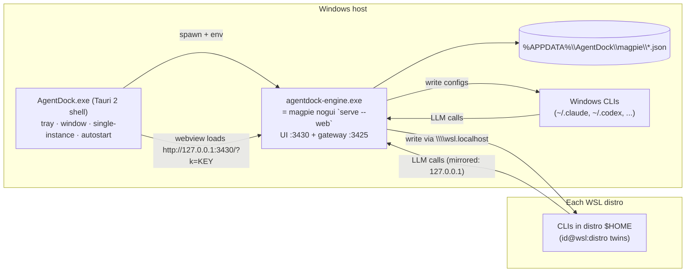

# Design — AgentDock (Unified Windows/WSL agent manager)

Research backing: `research/*.md` (anchors are relative to `engine/` = vendored magpie, or `/mnt/x/cc-switch` for shell sources).

## 1. Architecture



- **Single engine, single writer** (D1, D5): magpie owns providers, routing groups, library (skills/MCP/instructions/hooks/subagents), agent wiring, WSL twins. The shell holds no product data.
- **UI** (D2): the Tauri window navigates to magpie's own web UI. No React frontend is shipped. Magpie `/api` is same-origin from that page, so its cookie + `noFramedAPI` guards (`internal/gui/web.go:67,196`, `internal/gui/pluginpage.go:215`) pass unchanged.
- **Platform**: Windows x64 only. WSL features are gated on `GOOS==windows` (`internal/wslrun/wslrun.go:40-41`).

## 2. Repository layout

```
AgentDock/
  engine/                 # git subtree of github.com/yetone/magpie (D4)
    plugins/environments/ # NEW plugin manifest (G1)
    internal/environments/# NEW Go package: env model, G3 wslconfig, G5 sync, WSL-magpie import
    internal/gui/environments.go            # NEW /api/environments* routes
    internal/gui/assets/plugins/environments/ # NEW client.js, environments.css, i18n.js
  shell/                  # NEW minimal Tauri 2 app (extracted from cc-switch)
    src-tauri/{Cargo.toml, tauri.conf.json, src/{main.rs, lib.rs, sidecar.rs, tray.rs, auto_launch.rs}, capabilities/, icons/}
    dist/index.html       # static splash shown until engine is ready
  scripts/build-engine.ps1  # go build -tags nogui → shell/src-tauri/binaries/agentdock-engine-x86_64-pc-windows-msvc.exe
  LICENSES/               # MIT notices for magpie and cc-switch
```

## 3. Shell (from cc-switch)

Source anchors (`research/cc-switch-shell-extraction.md`): `src-tauri/src/lib.rs:354-418` single-instance, `456-464` process/dialog/opener/window-state, `473-518` log, `1135-1191` tray build, `1827-1873` ExitRequested, `2231-2265` window-state restore; `tray.rs:2062,2396,2651` menu/show/events (keep show/hide/quit only); `auto_launch.rs:34-68` (`auto-launch` 0.5 crate); `CREATE_NO_WINDOW` pattern `commands/misc.rs:25`.

Dropped: SQLite, proxy, per-CLI writers, React UI, deep link, store, updater (no release infra), `decorations=false` custom title bar (magpie UI has no window controls → native decorations).

Sidecar lifecycle (`sidecar.rs`):
1. Generate/persist a web key (≥16 chars `[A-Za-z0-9._~-]`, `web.go:146-191`) in `%APPDATA%\AgentDock\shell.json`.
2. Spawn bundled `agentdock-engine.exe serve --web=127.0.0.1:<uiPort>` with `XDG_CONFIG_HOME=%APPDATA%\AgentDock`, `MAGPIE_WEB_KEY=<key>`, `CREATE_NO_WINDOW`, assigned to a Windows Job Object with `KILL_ON_JOB_CLOSE` so the engine dies with the shell.
3. Poll `GET http://127.0.0.1:<uiPort>/` until 200 (timeout 20 s → splash shows error + log path).
4. Navigate main window to `http://127.0.0.1:<uiPort>/?k=<key>`.
5. Ports: gateway 3425 / UI 3430 by default. If 3425 is already bound, magpie still serves `/api` and does not kill the other process unless the user uses take-over (`internal/gui/gateway_takeover.go:45`); the shell shows a non-blocking notice "another magpie/gateway holds :3425" (D5: notify, never auto-kill).
6. Quit from tray → terminate job → exit. Close button → hide to tray.

Tauri config: `bundle.externalBin = ["binaries/agentdock-engine"]`, NSIS target, identifier `com.agentdock.desktop`, `app.security.dangerousRemoteDomainIpcAccess` not needed (UI makes no Tauri IPC calls); capability limited to the local window.

## 4. Engine changes (additive-first, D4)

| Item | Kind | Files |
|---|---|---|
| Environments plugin registration | new + 1-line | `plugins/environments/environments.go`, `plugins/all/all.go` (+1 import) |
| Environments page client | new + tags | `internal/gui/assets/plugins/environments/*`, `internal/gui/assets/index.html` (+`<link>`, +`<script>` between `kernel.js` and `app.js`) |
| `/api/environments*` routes | new + 1 call | `internal/gui/environments.go`, `internal/gui/api.go:1128` (+1 call next to `libraryRoutes`) |
| Env model / G3 / G5 / import | new | `internal/environments/*.go` |
| G4 per-distro switch | edit | `internal/settings/settings.go:344-347` (+`WSLDistrosOff []string`, add to `KeepOwn` `931-938`), `internal/agent/wsl.go:811` filter, `internal/wslrun/wslrun.go:65-68` filter |
| G2 hooks/subagents to WSL | edit | `internal/library/hooks.go:133-157`, `internal/library/subagents.go:93-96`, UI guards `plugins/library/client.js` ~2259/~2465 |
| Branding | edit | `index.html:6-7,37-38`, `assets/icons/magpie.svg`, `favicon.svg`, sign-in page `web.go:284` |

Upstream-touching edits are confined to the rows marked *edit* / *1-line*; record them in `engine/AGENTDOCK_PATCHES.md` so each `git subtree pull` has a checklist.

### 4.1 G1 Environments overview + G4 per-distro switch

`GET /api/environments` →
```json
{"environments":[
  {"id":"windows","kind":"windows","state":"running","agents":7,"gateway":"http://127.0.0.1:3425",
   "hostListener":"up|down"},
  {"id":"wsl:Debian","kind":"wsl","distro":"Debian","state":"running|asleep","enabled":true,
   "net":"mirrored|nat|...","mirrored":true,"gateway":"http://127.0.0.1:3425","agents":5,
   "reach":{"status":"ok|blocked|unknown|not-probed","detail":"…","checkedAt":"2026-10-15T...Z"},
   "lastSeen":"2026-10-15T...Z"}],
 "wslconfig":{"path":"C:\\Users\\X\\.wslconfig","networkingMode":"mirrored","localhostForwarding":null}}
```
Sources: `distro` fields Name/Running/Net/Mirrored/Gateway/Has (`wsl.go:166-196`), cached `wsl.json` for asleep (`wsl.go:879-882`). Distros come from `wsl.exe -l -q` via `wslrun.Distros` (Docker Desktop's distros are excluded upstream, `wslrun.go:413-426`); running state comes from exported `wslrun.Up(distro)` (`wslrun.go:155`, backed by `wsl.exe -l --running -q`). Listing never starts a distro.

Two distinct signals — never conflated:
- **`hostListener`** (Windows row): TCP dial from Windows to `gateway.URL()`. It only proves the listener is up on the host. As `reach.go:243-247` notes, WSL can still be blocked by the Windows firewall, so it is not shown as WSL reachability.
- **`reach`** (per distro): measured **from inside the distro**.
  - Only enabled (G4) distros for which `wslrun.Up(distro)` is true are probed. `Up` reads a running list cached for at most `upAge` (`wslrun.go:133-136`). Asleep distros get `not-probed` plus their last cached result and age, and are never woken. Residual race: a distro that stops inside the `upAge` window or before the exec would be started by `wsl.exe -d`. This is the same exposure upstream accepts for `Find`; it is documented, not hidden.
  - Exec: `wslrun.Run(5*time.Second, "-d", distro, "--exec", "sh", "-c", reachScript, "sh", url)` (`wslrun.go:44-48`, context timeout kills the call). `url` = `distro.base()` + `/api/hello` (`wsl.go:250-255`; endpoint `gateway.go:610-612` returns `{"name":"magpie"}`).
  - `reachScript` tries in order: `curl -fsS -m 3`, then `wget -q -T 3 -O -`, then a bash `/dev/tcp` connect (TCP only). The first available tool decides.
  - Status mapping: `ok` = HTTP body contains `"name":"magpie"` (or the TCP connect succeeded when only `/dev/tcp` was available, flagged in `detail`); `blocked` = connection refused or timed out; `unknown` = no probe tool, `wsl.exe` error, or 5 s timeout.
  - Concurrency: at most 4 distros probed in parallel. Results are cached for 30 s; `POST /api/environments/reach/refresh` forces a re-probe. Page loads read the cache and never block on `wsl.exe`.
- When `reach=blocked` and `hostListener=up`, the card shows `reach.go`'s advice: firewall, Share on local network, or mirrored, the last via the G3 button.

`POST /api/environments/{distro}/enabled {"enabled":bool}` → updates `Settings.WSLDistrosOff`; disabled distro: no twins, no probe, no writes. Global `NoWSLAgents` still overrides everything.

### 4.2 G5 Cross-environment sync

`POST /api/environments/sync/preview {"source":"codex@wsl:Debian","targets":["codex","codex@wsl:Ubuntu"]}` → per-target diff; `POST /api/environments/sync/apply` same body → applies.

Copied per target (same agent kind only):
- every agent `Field` value (`model`, `effort`, …) via `agent.Pick` (the same path as `POST /api/set`, `api.go:863-892`);
- connected/disconnected state (`POST /api/agents/{action}/{id}` semantics);
- library bindings: add/remove target id in `Instructions.Agents`, `Server.Agents`, skill agents, `Hook.Agents`, `Subagent.Agents` to mirror the source, then `library.Sync()`.

Not copied: model catalog visibility (already shared via `ListsFor`, `wsl.go:619-631`), credentials/logins, sessions. Target asleep → apply is refused for that target with reason "distro not running" (writing would start it). Targets overwrite; preview is mandatory in the UI before apply.

### 4.3 G2 hooks/subagents to WSL

Remove the WSL early return in `hookSpecOf`/`subagentSpecOf`; resolve target dirs via `wslTargetOf` (`targets.go:576-612`, UNC `\\wsl.localhost\<distro>\home\...`). Hook command translation, mirroring MCP's WSL policy (`mcp_wsl.go:31-39`):
- Windows drive paths (`C:\...`) → `/mnt/c/...` via `wslrun.Linux` (`wslrun.go:336-348`);
- commands that resolve to a Windows `.exe`/`.cmd`/`.ps1` → not written to WSL; the chip shows "Windows-only command" reason;
- other commands copied as-is.
Subagents are markdown files → copied unchanged. Asleep distro → not written (same rule as skills).

### 4.4 G3 Switch to mirrored (D6)

`GET /api/environments/wslconfig` (read existing parser `wsl.go:1358-1392`).
`POST /api/environments/wslconfig/mirrored` → writes `%USERPROFILE%\.wslconfig`: backup to `.wslconfig.agentdock-<timestamp>.bak`, preserve encoding (UTF-8/UTF-16) and unrelated keys, set `[wsl2] networkingMode=mirrored`, remove `localhostForwarding=false`. Returns running distros.
`POST /api/environments/wsl/shutdown {"confirm":true}` → `wsl.exe --shutdown`. UI: two explicit confirmations (write file; then shutdown listing affected distros, warning docker-desktop and open sessions stop). No admin, no firewall, no portproxy.
Unsupported Windows (build < 22621) → button disabled with reason.

### 4.5 First-run import (D5)

Engine data dir: `XDG_CONFIG_HOME=%APPDATA%\AgentDock` → magpie resolves `%APPDATA%\AgentDock\magpie` (`appdir.go:223-234`).
First run (no `providers.json`): Environments page shows an import banner:
- cc-switch: existing `GET/POST /api/importapps` with source `cc-switch` (`gui/importapps.go:27-85`, `provider/importapps.go:489-499`) + library `ccswitch.go` skills.
- WSL magpie: new `GET /api/environments/import/magpie` scans running distros for `~/.config/magpie/providers.json` via UNC; `POST` merges providers/groups by id (existing id wins; conflicting ids get suffix `-wsl`), never overwrites existing keys. Read-only on the source.

## 5. Compatibility & risks

| Risk | Mitigation |
|---|---|
| Upstream magpie churn breaks patches | Additive files; patch list `engine/AGENTDOCK_PATCHES.md`; run `go test ./...` after every subtree pull |
| Upstream tests pin plugin registration/index.html order (`TestPluginsImportOnlyCore`, `TestBuiltinClientsLoaded`) | Follow their rules exactly (see `research/magpie-extension-points.md` §1) |
| Two engines writing the same CLI configs (WSL magpie or standalone magpie) | Detect running `magpie` processes (Windows + running distros) and :3425 owner; show warning; never auto-kill |
| `wsl --shutdown` kills user work | Two confirmations + list of distros |
| `.wslconfig` corruption | Backup + encoding-preserving rewrite + rollback button using latest backup |
| Hook commands unusable in WSL | Translate drive paths; refuse Windows executables with visible reason |
| Orphan engine process | Job Object `KILL_ON_JOB_CLOSE` |
| Host-side dial mistaken for WSL reachability (firewall can still block WSL, `reach.go:243-247`) | Separate `hostListener` vs in-distro `reach`; probe from inside each running distro with a 5 s bounded `wsl.exe`; `unknown` rather than guessing |
| Reach probe wakes a stopped distro / floods `wsl.exe` | Gate on `wslrun.Up`; asleep → `not-probed`; ≤4 parallel; 30 s cache; page reads cache only |

Rollback: AgentDock data is isolated in `%APPDATA%\AgentDock`; magpie's own "applied/stash" restore (`applied.json`, `stash.json`) returns CLI configs to their pre-AgentDock state on disconnect.
