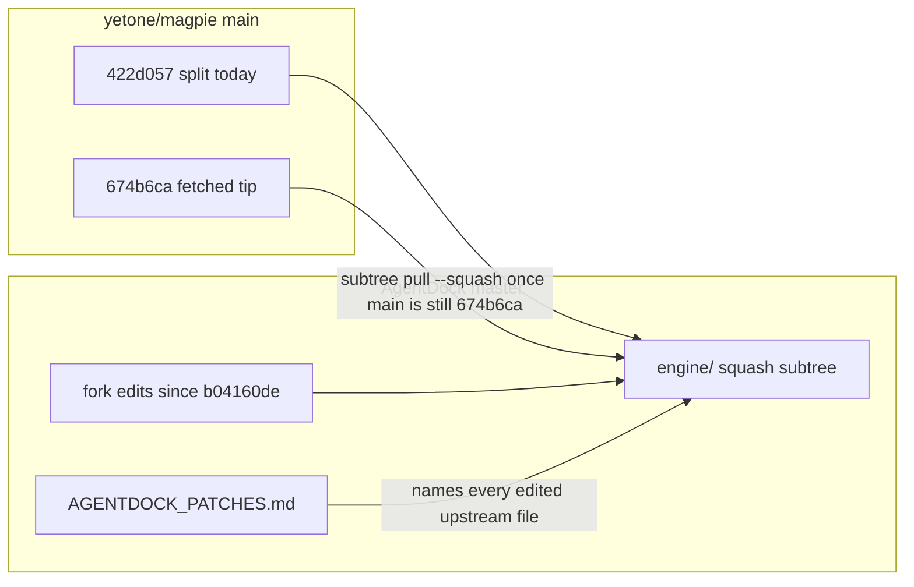

# Design — Sync vendored magpie subtree

PRD decisions D1–D4. No new runtime component.

## Boundary



`engine/` stays the only vendor tree. `shell/` is not in this sync. Fork-only files stay fork-only; they ride through a squash pull because upstream has no path for them, unless the pull reports add/add.

## What a squash pull actually does

`git subtree pull --prefix=engine <url> main --squash` fetches `main`, squashes `422d057..main` into one commit whose tree is upstream `main`, then merges that commit into `HEAD` while prefixing paths with `engine/`. The new commit message must contain `git-subtree-dir: engine` and `git-subtree-split: <sha>`. That split is the parent of the next pull. There is no per-commit history to cherry-pick.

The command reads the live URL, not `refs/tmp/magpie-main`. D1 holds only if `git ls-remote` still prints `674b6ca2881f1289c4ccdec158762978a463320c` for `refs/heads/main` immediately before the pull. If it does not, stop. Do not pass a raw SHA to `subtree pull` (it wants a ref), and do not pull the new tip inside this task.

## Conflict rule (D2)

Subtree merge uses the normal recursive merge. A clean auto-merge is accepted. A conflict is resolved per hunk:

| Hunk | Resolution |
|---|---|
| Upstream only | take upstream |
| AgentDock only | keep AgentDock |
| Same lines, both sides, behaviors can both exist | keep both |
| Same lines, behaviors exclude each other | keep the AgentDock behavior; write the dropped upstream hunk into the task notes |

Never `checkout --ours` or `--theirs` for a whole overlapping file. Expected overlap, not yet merged: `internal/agent/agents.go`, `internal/library/targets.go`, `internal/gui/assets/i18n.js`. An add/add on a file AgentDock created (native inventory, `internal/environments/`, environments plugin) stops the pull for that path and is resolved the same way; it is not assumed absent.

Known upstream edits to re-apply by hand if the merge cannot:

- `agents.go` / `targets.go`: Cursor editor `~/.cursor` is not the Cursor CLI; `cursor-agent` is its own row (`486ea8237`, `a80bc3009`).
- `i18n.js`: brand strings AgentDock added (Environments name/sub) stay; upstream translation and copy changes stay.

## Checklist contract

`engine/AGENTDOCK_PATCHES.md` is the review sheet for this pull and the next one. Three sections, nothing else:

1. Split: current `git-subtree-split` and the date it was pulled.
2. Edited upstream files: every path whose content differs from that split for a reason other than "we added a file upstream does not have". One line each: path and why.
3. Fork-only files: paths with no upstream counterpart.

Before the pull, section 2 must include the files the MVP list missed (`appdir`, `testenv`, agent discovery files, `library.go` / `mcp.go` / `skills.go` / `sync.go` / `targets.go`, library `i18n.js` / `library.css`) and section 3 must include native paging. After the pull, section 1 becomes `674b6ca` and section 2 gains a line for any file whose conflict dropped an upstream hunk.

Classification compares the current split's root tree with `HEAD:engine`. `422d057:engine/<path>` does not exist: the split stores files at the repository root. `git diff b04160de HEAD -- engine` is only the historical fork delta before this pull; after the pull it also lists upstream files added since `422d057`, so it must not be reused as the fork inventory.

```bash
git diff --name-status 422d057ded55e4eddf0b719bf2229e537c1fef24 HEAD:engine
```

After the pull, replace the split with `674b6ca2881f1289c4ccdec158762978a463320c`. The next sync uses whatever split was just recorded, never `b04160de` again. `M` is an edited upstream file. `A` is fork-only. Re-check the three overlap files against `674b6ca` directly (`git diff 674b6ca2881f1289c4ccdec158762978a463320c:internal/agent/agents.go HEAD:engine/internal/agent/agents.go` and the two siblings) so a silent ours-win is visible.

## Dirty paging (D4)

The uncommitted diff is the paging work, not a throwaway. Commit it alone, before touching the checklist, so the squash merge cannot absorb it. Message states it is unfinished and not smoke-tested. If `git status` shows anything else, stop; do not `git add` unrelated paths.

## Rollback

The pull is one merge commit. Before running it, record `git rev-parse HEAD`. Aborting a conflicted merge (`git merge --abort`) returns to that commit only if the paging commit and the checklist commit are already parents. Do not `reset --hard` a conflict away. After a bad resolution, `git revert -m 1 <merge>` drops the upstream squash and keeps the paging and checklist commits.

## Verification

Windows, from `engine/`:

```text
go vet ./...
go test -tags nogui ./...
```

Parent AC10 already recorded upstream-failing packages (`cli`, `gateway`) and a flaky `TestFXStateDoesNotWait`. Those are not regressions. A failure is new only if the same package and test are green at `b04160de` and red after the pull, and red on a throwaway checkout of unmodified `674b6ca` means it is upstream's. This task does not rebuild the Tauri shell.
