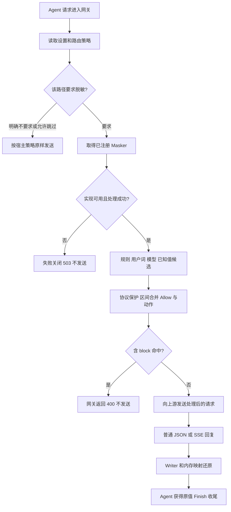

# 脱敏插件核心源码、实现机制与技术路线

## 1. 结论与分析边界

本实现不是对提示词做一次正则替换的“小插件”，而是一套面向 AI 网关的**本地可逆脱敏管线**：规则、用户词和可选本地模型发现敏感区间，发送前替换为稳定标签或保形假值，接收回复时在内存映射中找回原值；JSON、工具参数、签名思考内容和流式 delta 分别处理。

- 插件入口：`engine/plugins/redact/redact.go:19-32`。
- 算法主体：`engine/internal/redact/`。
- 设置与模型适配：`engine/internal/masking/masking.go:21-53,82-154`。
- 契约与失败策略：`engine/internal/gwmw/gwmw.go:76-132,250-288`。
- 网关传输决策：`engine/internal/gateway/redact.go:30-66,112-193`。

本文以打包时磁盘源码为准；所列路径/行号对应归档原文件。现有架构文档提供设计背景，不作为实现绝对正确的证明。图索引曾返回旧的 MaskJSON 实现，因此已逐项核对当前源码。后文“建议路线”是复用建议，不是本次新开发功能；本次不修改算法或宿主业务代码。

## 2. 模块分层与源码导读

| 层级/文件 | 负责的行为 | 阅读重点 |
| --- | --- | --- |
| `plugins/redact/redact.go` | 内置插件注册、依赖与资源声明 | Essential、InUse、Apply/Dispose |
| `internal/masking/masking.go` | 每次读取设置、转换 Options、适配模型和 hits | Wanted、ContextTeller、Writer/Finish |
| `internal/gwmw/gwmw.go` | Masker/Teller 接口、注册栈、刷新及异常转换 | 脱敏失败关闭与普通 Agent 中间件失败放行不同 |
| `internal/redact/redact.go` | 规则、敏感区间、替换、标签、原值映射和还原 | Options、Mask、apply、Restore |
| `internal/redact/rules.go` | 用户自定义前缀/RE2 规则与校验 | 上限、捕获组、编译缓存 |
| `internal/redact/more.go`、`ids.go` | 扩展个人信息类别、上下文与 ID 保护 | 降低代码/协议误报 |
| `internal/redact/known.go` | 已知值再识别与已发送文本缓存 | 同一历史前缀的稳定性 |
| `internal/redact/json.go` | 保留字节风格的 JSON 遍历、签名对象及嵌套参数 | 不是全树反序列化后无差别替换 |
| `internal/redact/writer.go` | 完整响应及 SSE 跨事件还原 | pending、事件上下文、Finish |
| `internal/redact/shape.go` | 保持密钥外形的确定性假值 | 前缀、长度、字符类、冲突回退 |
| `internal/redact/model.go`、`zhname.go` | 模型区间接入、误报过滤及中文名字处理 | 模型不是最终裁决者 |
| `internal/redact/scrub.go` | 面向日志/归档的不可逆清理 | 不等于 Mask/Restore |
| `internal/pii/`、`pii/guard/` | 模型获取、进程生命周期、Go 内推理 | 不属于正则核心的硬依赖 |
| `gateway/redact.go`、`masked.go`、`internal/maskrec/` | 请求拦截、计数、观测与保留策略 | block/warn 及原值访问边界 |
| `internal/gui/masking.go`、`assets/plugins/redact/` | 预览、记录、原值展示及插件页面 | 权限来自宿主，不来自脱敏算法 |

表中除 plugins 之外的相对路径均在 `engine/` 下。完整文件清单见 SOURCE-INDEX.tsv。

## 3. 运行时处理链

源码依据：`plugins/redact/redact.go:19-46` 注册 ID=redact，Requires=settings/gateway、Essential=true；Apply 用 `gwmw.Mask(masking.Masker{})` 注册，dispose 时撤销。Wanted 是 Secrets、Personal 或非空 Words（`masking.go:21-24`）；单独开启模型不构成 Wanted。

`gwmw.Mask` 是可撤销注册栈，最后一个服务；缺失时最多每秒请求一次 refresh 后重查（`gwmw.go:172-210,234-276`）。`Safely` 把 matcher/model panic 转为错误（`:279-288`）。普通 JS Agent 中间件失败放行不代表脱敏也会失败放行。

`gateway/redact.go:30-66` 优先用支持取消等待的 JSONHitsContext，其次 JSONHits 或 JSON；有替换时挂载回复 Writer。核心只发现/替换：HTTP 是否发送与 400/503 状态由网关承担，直接调用 Mask 并不会替调用者阻断网络。

## 4. 检测算法与决策顺序

### 4.1 候选发现

内置规则覆盖私钥、常见 API key、JWT、连接串密码、配置赋值，以及邮箱、电话、证件/卡号等。每条 rule 可以带正则、marker、大小写折叠 marker、边界、校验和或上下文验证（`redact.go:94-128,136-182,759-810`）。

性能不是靠对所有文本运行所有正则：先做廉价 marker 筛选；需要大小写判断时才计算 lower；部分规则限定上下文窗口。规则本身在程序中编译，自定义规则用 sync.Map 缓存（`rules.go:113-142`）。这些设计不等于已做吞吐基准，本次未声称任何性能指标。

扩展类别见 `more.go:26-59`：

- Personal 打开时默认启用 SSN、护照、IBAN、生日、MAC、序列号。
- 用户主目录名、user@host、公网 IP、云 bucket 默认关闭，避免影响路径与代码复制。
- 生日需要 DOB/生日等上下文，IBAN 有校验规则；不是所有日期、所有数字或所有 IP 都必遮。

### 4.2 用户规则与合并

`Rule` 接受 Kind、Prefix 或 Regex；两者不能同时设置。Regex 使用 Go RE2，存在捕获组时规则以首组作为待替换值（`rules.go:10-20,68-110`）。

当前限制：最多 32 条；Kind 最长 24；Prefix 长度 3–64；Regex 最长 300；前缀后匹配至少 8 个指定字符；普通自定义匹配值至少 4（`rules.go:23-33`）。保存入口校验无效规则；手工配置中的无效编译规则在运行时可能被忽略（`:119-142`），因此不能把任意手写配置都描述为可靠 fail-closed。

候选加入顺序是用户词 → 自定义规则/内置规则 → 模型 → 已知值；自定义规则仅在 Secrets 下运行（`redact.go:728-827`）。最终胜出规则在 `apply` 中统一决定：

1. 去掉落在已有占位符或已知保形假值中的候选。
2. 起点更早优先；起点相同则更长优先；区间完全相同用稳定顺序保留先加入者。
3. 已被前面候选覆盖的区间不重复处理。
4. 整值 Allow 比较不区分大小写；允许的值原样保留。
5. 默认 mask；warn 原样保留并报告；block 替换并报告，让网关阻断。

依据：`redact.go:1087-1157`。不能笼统表述为“模型优先”或“所有自定义命中一定压过任何内置命中”，因为起点/长度优先仍适用。

### 4.3 协议和误报保护

`ids.go:8-55,86-126` 保护 UUID 和长 hex 标识，防止电话/银行卡规则只改掉一截，造成后端查不到 ID。凭据上下文和用户明确词/规则有不同处理；这是一种兼容策略，不是完整敏感数据分类器。

`redact.go:926-994` 对小数片段、裸 JSON 数字进行个人信息误报排除。邮箱还考虑 publicsuffix 与示例域等（`redact.go:379-423`）；使用 example.com、.test 等示例地址不适合证明真实邮箱规则被触发。

模型候选经过标签映射、范围/UTF-8、格式、边界和上下文检查；数字账户、时间戳、工具 ID、snake_case、版本/摘要/路径和助手名字等都存在保护（`model.go:27-95,109-161,256-284`）。用户自定义模式、Allow 和种类开关也可能改变结果，不能给出“模型看到任何敏感值都必遮”的承诺。

## 5. 稳定标签、原值记忆和缓存

### 5.1 标签不是加密密文

`tag` 计算：

`HMAC-SHA256(32-byte key, kind + NUL + original)` → Base32 无填充 → 取前 8 字符转小写 → `{{KIND_suffix}}`。

依据：`redact.go:490-566`。同一类型和值在同一 key 下结果确定，有利于历史、缓存和签名兼容。标签本身不可用来解密；还原依赖内存中 placeholder → value 映射。

key 可以通过 `SetKeyPath` 持久化，默认路径为空时仅在内存。读取已存 key 或生成 32-byte 随机 key，创建目录/写 key 的模式为 0700/0600（`:518-542`）。这些是创建时请求的模式，不声称会修复原已存在文件的所有权限。宿主原值不落盘与 key 不落盘是两回事。

### 5.2 有界记忆，不是 LRU

原值映射用进程全局 RWMutex 保护；达到 200000 项后删除一半，删除保形索引并重建已知值索引（`redact.go:490-500,556-584`）。注释写 oldest，但实际是遍历 Go map 删除，没有时间队列，因此不能称作最老优先或精确 LRU。

已知值用索引辅助匹配，短于 8 bytes 的值与 TERM 不同等加入 known（`known.go:29-55`）。重启、淘汰或换 key 后仍可能见到无法还原的历史标签；后续请求带来原值时可再次建立映射，不能把这推广为任何历史响应都能恢复。

### 5.3 历史缓存稳定性

如果新一轮发现某个值，回头把已经发送过的历史前缀也改掉，会破坏 prompt cache。`sentKnownSpans` 保存文本与 Secrets/Personal/Kinds 哈希对应的已知值区间，两代每代 65536 项，复用首次发送时的决定（`known.go:215-277`）。

这是隐私与缓存一致性的明确边界：不能同时无限宣称“以后任何地方都立即重遮”与“已发送历史的字节永不变化”；实现对已发送同文本有缓存约束。

## 6. JSON、工具参数与签名兼容

### 6.1 结构遍历

`walk` 逐字符串处理原始 JSON；未改动内容尽量保持原始字节，避免重序列化整个请求（`json.go:206-232`）。MaskJSON 非 JSON 时回退文本，而不是直接认作无需处理（`:383-419`）。

`keepIn` 区分模型/协议 ID、工具定义、JSON schema 与工具参数，防止把 enum、grammar 或调用 ID 改坏；描述与实际消息/参数的处理不能混为一谈（`json.go:27-60,75-177`）。因此工具定义及协议元数据有明确豁免，不宜把它当覆盖任意字段/任意二进制的 DLP。

工具调用的 `arguments` 常是“JSON 字符串中的另一层 JSON”。`asJSON` 判断这类字段；匹配时使用等长度 unescaped view，并防止区间切在转义字符内部；保存待还原值时解开其内部转义，返回时再正确转义（`redact.go:705-727,830-923`，`json.go:472-496`）。只做 strings.ReplaceAll 会在此破坏 JSON。

### 6.2 已签名内容两遍处理

思考文本、Gemini thoughtSignature 或 Responses 加密推理关联文本必须与厂商原来签名的内容一致。MaskJSON 先扫描 signed/args/defs，普通文本按规则处理，signed 区域先不重新推断；第二遍将本次已经替换过的值及已知秘密重遮回相同标签，不把厂商自行写出的新个人信息误遮成另一份签名文本（`json.go:368-448`）。

这是兼容策略，不是任意签名校验器；归档提供现有 `TestSignedThinkingGoesBackAsSigned` 作为行为依据，未对所有厂商/所有未来字段做穷尽证明。

## 7. 保形假值

当 Shape 打开，符合要求的秘密可用相同前缀、长度、分隔符和字符类的确定性假 key，而不是 `{{...}}`，避免模型因占位符而评论或破坏格式检查（`shape.go:12-30,85-162`）。

- 当前最短 **8** 字符且至少 **6** 个位置生成；不是既有部分说明中的 16。
- 只适用秘密类，不适用个人信息类和 TERM；字符集限字母、数字、`-_.`。
- HMAC 派生字节决定替换字符；hex 值保留大小写类别和分隔符。
- 不合格或保形结果与已记忆的不同原值冲突时回退普通标签（`:165-187`）。

它是格式保持的假名化，不是格式保持加密；前缀/长度/字符布局会泄露结构信息，模型仍不能据真实 key 判断其有效性。

## 8. 普通响应与 SSE 还原

`Writer` 包装 http.ResponseWriter，支持 Header、Flush、Unwrap、Put 与 Finish；Finish 必须在处理结束时调用（`writer.go:18-58,160-185`）。

- 普通响应：缓存 body，在 Finish 中 RestoreJSON；不是任意大小响应的零内存流转换。
- SSE：收集完整 `\n\n` 或 `\r\n\r\n` 事件；只对合适的 JSON data 处理，保留事件外壳。
- 跨 delta 标签：把可能未结束的尾巴放在 pending，匹配下个事件的上下文和 JSON path，再拼接还原；不同上下文则释放原事件，避免把不同输出/工具流误拼。
- keepalive 注释会及时放行，不被标签尾巴无限扣住。
- 非 identity Content-Encoding 在此层原样发送；不能说本层自动解压任何压缩响应。
- splitEvent 针对单条 JSON data 行，多 data 行有回退路径，不代表任意 SSE 扩展都是逐字段可逆。

依据：`writer.go:60-127,145-185,187-245,263-331`。`Restore` 还支持标签大小写/空格/少括号变体，但只在当前已记忆值中查找，且保证工具参数按 JSON 转义（`redact.go:1171-1267`）。

## 9. 可选本地模型技术路线

核心 `Model` 接口输入多个文本、输出 byte offsets 与标签（`model.go:16-37`）。MaskJSON 聚合可处理文本；`withModel` 去重并排除长度不足 3 bytes 的文本，再调用一次回调（`json.go:389-399`，`model.go:229-253`）。规则与模型合并后仍经过同一保护和决策管线，不依赖模型独立裁决。

宿主有两条实际实现路径：

| 路径 | 源码与执行方式 | 外部材料 |
| --- | --- | --- |
| AstrLink Guard | `pii/astrlink.go:17-47`，Go 进程内 CPU int8 ONNX token classifier，推理在 `pii/guard/`，含 amd64/arm64 汇编与通用内核 | 固定 revision 的 ONNX 数据与 tokenizer，逐文件 hash/size 固定 |
| Privacy Filter | `pii/pii.go:5-26,41-63`，本地 GGUF 经独立 pf-serve helper；GPU 不适合时按原实现尝试 CPU | 固定 GGUF 与各平台 helper，native/privacy-filter 给构建入口和补丁 |

AstrLink 的三份材料大小由 `astrlink.go:34-38` 定义；Privacy Filter 的 GGUF 为 1,637,572,192 bytes（`pii.go:43-46`）。源码注释给出的粗略 MB 不作为下载大小的精确值。

模型获取与启用不是一回事：GUI 下载成功后才保存启用设置，切换期间用原模型/规则保持旧策略（`gui/privacymodel.go:109-136`）；启用后的 Find 失败或等待取消会 panic，经 Safely 失败关闭，不悄悄仅用规则发出（`masking.go:42-53`，`gwmw.go:279-288`）。

原生 helper 的外部上游 URL/commit 和补丁应用在 `native/privacy-filter/build.sh:5-43`。本包收录自有 helper 源码与构建材料，不包含其外部 checkout、GPU SDK、模型或预编译程序。本次只执行模型回放测试，没有实际加载权重，不能据此宣称模型实机推理/精度已验证。

## 10. 观测、权限与风险边界

### 10.1 观测并非保存一份明文请求

Hit 包含 kind、finder、placeholder、action、头部 hint、长度；不是完整原值（`redact.go:621-665`）。maskrec 的磁盘记录保留 30 天、总计上限 100MiB；snips、还原次数和最近 sent body 在内存。sent 最多 100 条，单条 4MiB，总预算 64MiB（`maskrec.go:1-13,33-87`）。提示长度和前缀仍是元信息，不是“零信息泄露”。

`GET /api/masking/value` 和 `POST /api/masking/values` 会返回还在内存里的真实值；sent 返回厂商收到的请求，设置 no-store（`gui/masking.go:139-180`）。管理界面是可信边界的一部分，不应把这些路由直接裸露为公共 API。Web 模式经 webGuard 的 key/cookie 与外层 AllowGuard（`gui/web.go:196-260,327-335`）；本分析没有做完整 GUI 安全审计，不将单个路由的 Cache-Control 当作鉴权。

### 10.2 已确认或推导的限制

| 边界 | 源码依据 | 正确解读 |
| --- | --- | --- |
| warn、Allow、明确不脱敏路由 | `redact.go:1122-1157`；`gateway/redact.go:228-270` | 用户明确允许的值/路径可能原样发送，不是检测失败 |
| 标签仅 40-bit 截断 | `redact.go:550-566` | 普通标签生成未见碰撞消歧；潜在碰撞风险来自源码推导，本次未构造碰撞 |
| key 读写和随机读取错误被忽略 | `redact.go:530-542` | 不能宣称 key 持久化失败一定触发 503；本任务不修复该行为 |
| 进程全局记忆 | `redact.go:490-496,633-638` | 不提供按租户/请求的映射隔离；移植多租户服务需重新设计此边界 |
| 淘汰与重启 | `redact.go:569-584` | 原值映射可能消失，不能无限还原历史标签 |
| 协议保护与模型误报过滤 | `json.go:27-60`；`ids.go:8-55` | 兼容性优先的豁免可能保留数据；不能替代所有字段/载荷的完整防泄漏策略 |
| 缓冲和压缩响应 | `writer.go:60-72,89-101,166-185` | 不保证任意大 body 的有界缓冲，也不在此层还原压缩响应 |
| 不可逆 Scrub 与可逆 Mask | `scrub.go:11-55` | 日志/归档清理输出 [REDACTED:KIND]，不产生可还原映射，不受相同 UI 开关语义约束 |

保护范围是经过该网关且进入相应处理路径的文本，不包括客户端绕过网关直连厂商、所有 HTTP 头、图片像素、音频字节等任意数据。模型的 prompt injection 防护也不是该脱敏系统的目标。

## 11. 源码复用与落地路线（建议，非本次新增实现）

### 路线 A：先复用纯算法

适用于自有 Go 服务已有配置/网关：保留 internal/redact 的整包行为和 publicsuffix 依赖，先关闭模型，接入 Mask/MaskJSON 与 Restore/Writer；在进程开始前决定 SetKeyPath。必须保证响应经过同一映射上下文，完成后调用 Finish，工具参数/签名路径不要用一次正则替换取代。

Go internal 限制意味着外部工程不能任意 import 当前路径。可以在本模块父目录范围内使用，或在保留 MIT 的前提下迁移包并修改模块路径；后者是将来移植工作，本次没有改原始源码。

### 路线 B：接入网关策略与观测

复用 Masker、Teller、ContextTeller 契约；要求脱敏但实现不可用时失败关闭。把 block 的拦截留在发送前，warn/Allow 的放行明确告诉用户。将配置读取、key 存储、超时/取消、路由跳过和原值查询鉴权设计成宿主职责，不只复制插件 init。

若需要现有管理体验，还需接入 settings、pluginrt、maskrec 和对应 GUI；归档中的参考文件帮助追踪，但不是可直接运行的完整 UI 服务。

### 路线 C：需要时再接入本地模型

先用现有回放评估规则与融合策略，再按平台/资源选择 Go 内 CPU 或独立 GGUF helper。维持 byte offsets、文本去重、标签过滤和 context 取消；启用模型后的错误不要悄悄降级成仅规则。下载完整性、模型许可与运行时资源由宿主承担。

### 不能在移植时丢掉的验收

- 请求替换、非流式回复、跨事件/跨网络块 SSE 还原。
- JSON 嵌套 arguments、协议 ID、工具 schema、已签名推理的往返。
- 默认 mask / warn / block / Allow / route opt-out 的区别。
- 模型失败、请求取消、无注册实现时的实际发送行为。
- key 生命周期、映射淘汰、缓存前缀及原值 API 的隔离与权限。

## 12. 本次交付与实际验证

原始来源/资源共 350 文件，2,455,501 bytes，按原始 engine 路径归档，逐文件 SHA-256 身份记录在 SOURCE-MANIFEST.sha256；分类见 SOURCE-INDEX.tsv。它包含四目标包所需本地依赖与原有测试，同时将宿主集成材料标为 reference，不能以精简包构建整个 AgentDock。

已实际运行并通过：

1. 原仓库四目标完整现有测试（取消 MAGPIE_EVAL_CACHE）。
2. 原仓库五个网关边界用例：请求脱敏、block 不发、warn 原样、签名思考往返、工具 ID 保持。
3. 解包后四目标测试，无删改测试来满足依赖。
4. 临时 go run：文本 2 处替换；嵌套 JSON 4 处替换且往返相等；SSE 三个内容事件、六个网络片段、标签跨两个事件边界，最终还原相等且 keepalive 保留；warn 报告但不替换。

测试输出、归档成员/哈希/CRC 校验及未覆盖项见 verification.txt。没有运行完整仓库全部测试、Windows/macOS 构建、真实模型、桌面 UI、生产性能或完整安全审计；不把这些写成已验证能力。
